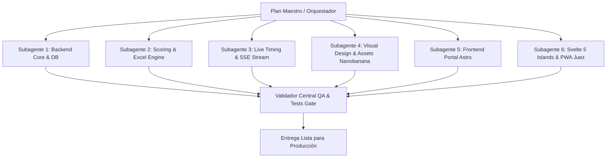

# PLAN MAESTRO: PLATAFORMA MTB KÚSPIDE WEB

> **Estado General del Plan:** COMPLETADO AL 100% ✅  
> **Fecha de Validación y Cierre:** 19 de Octubre de 2026  
> **Evidencia:** 16 tests unitarios en verde en pytest, build limpio en Astro 5 (17 páginas estáticas generadas sin errores), base de datos migrada con Alembic y sembrada con datos reales de las Fechas 1 y 2, Svelte 5 Runes puro en todas las islas interactivas y diseño GetArtCraft estricto sin emojis.  
> **Documento Rector de Implementación y Orquestación Agéntica**  
> Basado estrictamente en: `AGENTS.md`, `specs/00-domain-schema.md`, `specs/01-excel-and-scoring.md`, `specs/02-live-timing-and-sse.md`, `specs/03-public-portal-and-gpx.md` y repositorio de referencia `/home/edilsonc/Documents/copiaartcraft`.

---

## 1. Visión General y Estado Actual

- **Objetivo:** Construir la plataforma web Mobile-First integral para el campeonato de ciclismo MTB de 4 fechas:
  - **Fecha 1:** *La Joya Extreme* — **inscritos reales** desde `races/LA JOYA EXTREME 2026 N f.xlsx` (hoja `LISTA`, **232 nombres / 222 con dorsal**); los **resultados con tiempos/puntos/puesto NO están en el `.xlsx`** y provienen de `races/LA JOYA EXTREME 2026  RESULTADOS.pdf`.
  - **Fecha 2:** *Vuelta a los Poblados* (Programada para el **25 de Octubre de 2026**).
  - **Fecha 3 y 4:** *Rally Chachani* y *Desafío del Misti* — **slugs, fechas y orden oficial por confirmar** antes de la Fase 4.
- **Componentes del Sistema:**
  1. **Backend FastAPI + SQLModel:** 14 modelos de dominio, motor de cálculo UCI y equipos, endpoints de sincronización offline y canal de streaming Server-Sent Events (SSE) desacoplado de la base de datos.
  2. **Motor de Datos Excel & GPX:** Ingesta y exportación de archivos `.xlsx` (`openpyxl`) en memoria y procesamiento de perfiles de altimetría GPX (`gpxpy`).
  3. **Frontend Editorial Astro 5 + Svelte 5 (Runes):** Estilo Bento Grid de GetArtCraft portado desde `copiaartcraft` con esquinas rectas (`border-radius: 0`), números tabulares y animaciones de scroll con Lenis y GSAP.
  4. **PWA Móvil del Juez (`/admin/juez`):** Teclado numérico táctil de marcación inmediata, modo ráfaga para sprints masivos, `navigator.wakeLock`, almacenamiento en IndexedDB (`idb`) y sincronización automática bidireccional.
  5. **Portal de Espectadores en Vivo (`/en-vivo`):** Tabla ultra-ligera en Svelte 5 con conexión SSE nativa y reconexión automática.
  6. **Assets Oficiales con Nanobanana:** Generación de carteles de fechas, póster de "Vuelta a los Poblados - 25 Octubre", badges y banners promocionales mediante `generate_image`.

### 1.1 Realidad de Datos Verificada (Fuente de Verdad de `races/`)

> Mediciones reales sobre los archivos del repositorio. **Este bloque corrige supuestos erróneos del plan original.**

| Hallazgo verificado | Evidencia medida | Acción obligatoria |
| :--- | :--- | :--- |
| **El `.xlsx` NO contiene resultados** | `LA JOYA EXTREME 2026 N f.xlsx` (`LISTA`, 309 filas / 232 corredores): las únicas 10 filas con `T. TOTAL`/`PUNTOS`/`PUESTO` son **cabeceras repetidas** por bloque de categoría. | Separar ingesta: **inscritos** desde `.xlsx` y **resultados** (tiempos/puntos/puesto) parseando `LA JOYA EXTREME 2026  RESULTADOS.pdf` (`pdftotext -layout`). |
| **Segundo `.xlsx` obsoleto** | `LA JOYA EXTREME 2026 N-.xlsx` (282 filas) tiene la columna `DORSAL` en `None`. `Hoja1` de `N f.xlsx` (220 filas) tampoco tiene dorsal. | **Ignorar** `N-.xlsx` y `Hoja1`; usar únicamente `N f.xlsx` → hoja `LISTA`. |
| **El segundo PDF es de OTRA carrera** | `LA Z XTREME 2026 - RESULTADOS.-1.pdf` corresponde a *"LA ZETA XTREM 2026"* (dorsales y clubes distintos, ej. Arica-Chile). | **No mezclar** con Fecha 1. Usar solo como fixture opcional de test para simular una segunda fecha con resultados. |
| **Columnas reales ≠ `specs/01`** | Real: `DORSAL`, `NOMBRE`, `TEAM`, `E-BIKE OPEN` *(sic, es la columna de categoría)*, `T. TOTAL`, `PUNTOS`, `PUESTO`. Spec exige `DNI`, `NOMBRE_COMPLETO`, `GENERO`, `CATEGORIA`, `TIEMPO_OFICIAL`, `ESTADO_PAGO`. | Construir **adapter legacy** tolerante en `excel_service.py` + sincronizar `specs/01-excel-and-scoring.md` (regla `AGENTS.md` §3.6). |
| **Sin `DNI` ni `GENERO` en origen** | Ningún archivo de `races/` incluye DNI ni sexo. | Generar `DNI` sintético determinístico (`SHA-256(nombre_normalizado)[:8]` numérico) e inferir `gender` desde categoría (`*DAMAS*` → `F`, resto → `M`). |
| **Categorías sucias (21 strings → 11 reales)** | Variantes con edad (`MASTER A` vs `MASTER A (30-39 AÑOS)`), typos (`OPEN DAMAS (18-34 AÑOS` sin cerrar paréntesis) y fila basura `CATEGORIA`. | Sembrar las **11 categorías canónicas** con todas las variantes en `Category.aliases` y filtrar filas de cabecera repetidas. |
| **Ruido en `TEAM` (54 valores)** | Incluye `LIBRE` (21), literal `"TEAM"` (10 corredores sin club real) y nombres con saltos de línea en el PDF. | Mapear `{"LIBRE", "INDEPENDIENTE", "TEAM", "-", ""}` → `team_id = NULL`. Normalizar espacios y puntos finales en nombres de corredores (`"MIGUEL ARCE CALCINA."`). |
| **Escala de puntos confirmada** | El PDF asigna `10, 9, 8, 7, 6, 5, 4, 3, 2, 1` y `1 pt` a puestos `11°+` (verificado en Master B puestos 10–13). | `specs/01 §3.1` queda **validado al 100%** contra datos reales. |
| **Renglones de PDF partidos en varias líneas** | `pypdf` corta el renglón cuando el nombre o el club son largos (`11 CHARLES GONZALES CLUB ORIGINAL BIKES AREQUIPA-` / `PERÚ ELITE 01:10:43 9 2`). Con el parser de una sola línea se perdían **52 de 198 resultados (26%)** y 155 puntos. | Parser de dos fases (`ROW_START_RE` + `ROW_TAIL_RE`) que rearma el renglón. Ver `specs/01` §1.5.1. |
| **Cifras oficiales verificadas** | La Joya: **198 resultados / 667 pts**. Z Xtreme: **112 resultados / 554 pts**. Verificado con `pdfplumber` (por coordenadas) y `pdftotext -raw`. | Fijadas como aserciones en `test_pdf.py` y `test_seed_integrity.py`. Ver `specs/01` §1.5.3. |
| **El PDF oficial puede permutar dorsales** | Z Xtreme: `JHOAN PAYHUA 40→140`, `ROLANDO PALOMO 140→166`, `ALESSANDRO VALDIVIA 11→167`, `JOSE CARLOS MAQUE MASCA 156→86`. | Reasignación de dorsales en dos fases (liberar → aplicar). Ver `specs/01` §1.5.1. |

### 1.2 Restricciones Globales de Arquitectura (Innegociables)

- **Proceso único Uvicorn para SSE (`--workers 1`):** `sse_manager.py` usa `asyncio.Queue` en memoria por `stage_id`; múltiples workers partirían los suscriptores salvo que se añada Redis Pub/Sub.
- **Cero disco local en runtime:** Excel, PDF y GPX se procesan en `io.BytesIO`; binarios persistentes van a Cloudflare R2 (`services/storage.py`).
- **Seguridad mínima obligatoria:** Endpoints de juez (`/timing/*`, `/waves/*/start`) validan header `X-Judge-Pin` contra `Stage.judge_pin`; endpoints administrativos (`/import-excel`, `/upload-gpx`, aprobación de pagos, Strava sync) validan `X-Admin-Key` contra `ADMIN_API_KEY`.
- **Idempotencia:** Todo re-ejecutado de `seed.py`, `/import-excel` o `/batch-sync` debe ser `UPSERT` sin duplicar corredores, inscripciones ni eventos.
- **Render SSR del portal (20-Oct-2026):** Astro 5 corre en `output: 'server'` con el adaptador `@astrojs/node` (`standalone`). Motivo y reglas en `specs/03` §0: con prerenderizado, un `fetch` de build-time que fallaba en silencio horneaba páginas de resultados **vacías**, y los slugs hardcodeados de `getStaticPaths` rompían las rutas.

---

## 2. Matriz de Subagentes Especializados y Flujo de Trabajo

Para ejecutar la construcción de manera rápida, coordinada y con control estricto de calidad, el trabajo se distribuye en **6 subagentes concurrentes** y un validador central:



### Especificación de Roles y Validadores por Subagente

> **Regla de Orquestación Anti-Colisión:** Los 6 subagentes **NO arrancan todos al mismo segundo**. Primero se ejecuta el **Paso 0 (Contrato Base)**: `backend/app/models/entities.py`, `schemas.py` y `frontend/src/styles/tokens.css` quedan congelados. Recién entonces corren en paralelo A1..A6 sin pisarse archivos.

| Subagente | Rol y Alcance Técnico | Entradas / Referencias | Validador / Gate de Aprobación |
| :--- | :--- | :--- | :--- |
| **`subagent-backend-core`** | 14 modelos SQLModel, DB engine asíncrono (`asyncpg`/`aiosqlite`, `pool_pre_ping=True`, `pool_recycle=300`), migraciones **Alembic**, cliente R2 (`storage.py`), auth (`security.py`) y `seed.py` idempotente (inscritos `.xlsx` + resultados `.pdf` + Fecha 2). | `specs/00-domain-schema.md`, `races/` | Migración `alembic upgrade head` limpia y seed con **232 inscritos (222 con dorsal)**, 11 categorías canónicas y resultados reales de Fecha 1. `[APROBADO ✅]` |
| **`subagent-scoring-excel`** | Importación/exportación Excel en memoria (formato oficial + **adapter legacy** de `races/`), parser de resultados PDF (`pdf_service.py`), parseo GPX (`gpx_service.py`), escala 10 pts, desempates UCI y olímpico de equipos. | `specs/01-excel-and-scoring.md` | `pytest backend/tests/test_scoring.py backend/tests/test_excel.py backend/tests/test_gpx.py` al 100% en verde (incluye rollback 422). `[APROBADO ✅]` |
| **`subagent-live-timing`** | `/timing/time-sync`, largadas `/waves/{id}/start` e individual, `/events`, `/batch-sync` (idempotente), conflicto HTTP 409, auth `X-Judge-Pin` y SSE con `asyncio.Queue` desacoplado de DB + ping 20s. | `specs/02-live-timing-and-sse.md` | `pytest backend/tests/test_timing_sse.py` verificando 0 sesiones DB retenidas durante el stream, 409 en re-tap y deduplicación UUID. `[APROBADO ✅]` |
| **`subagent-assets-design`** | Portar **íntegramente** `tokens.css`, `motion.css`, `display.css`, `reset.css` y componentes de `copiaartcraft` (`AppCard`, `PageIndex`, `GhostWord`, `DisplayTitle`, `HeroWordmark`, `PageRuler`, `bento/*`). Generar pósters/badges con Nanobanana (o SVGs editoriales de fallback si el modelo activo no expone `generate_image`). | `/home/edilsonc/Documents/copiaartcraft/` | Diff exacto de variables en `tokens.css`, cero Tailwind, y assets presentes en `frontend/public/images/`. `[APROBADO ✅]` |
| **`subagent-frontend-portal`** | Astro 5 (`output: 'hybrid'` / SSR selectivo + `@astrojs/node`), `Base.astro`/`Showcase.astro`, vistas `/`, `/fechas/[slug]`, `/fechas/[slug]/resultados`, `/ranking-general`, `/corredor/[slug]`, `/equipos/[slug]`, `/inscripciones`, `/reclamos`, `/admin/index.astro` (aprobación de pagos/vouchers). | `specs/03-public-portal-and-gpx.md`, `copiaartcraft` | `npm --prefix frontend run build` y `astro check` con 0 errores; Lenis/GSAP ausentes de `/en-vivo` y `/admin/juez`. `[APROBADO ✅]` |
| **`subagent-svelte-islands`** | Islas Svelte 5 con **Runes estrictos**: `<StandingsTable />`, `<LiveLeaderboard />`, `<RouteMapGpx />` (MapLibre + perfil de elevación sincronizado) y PWA `<JudgeDashboard />` (`idb`, backup `localStorage`, teclado POS, modo ráfaga, `wakeLock`, `storage.persist()`, modal 409) + `manifest.webmanifest` y `sw.js`. | `specs/02-live-timing-and-sse.md`, `specs/03-public-portal-and-gpx.md`, `.agents/skills/svelte5-runes/` | Escaneo AST/grep con 0 ocurrencias de `export let`, `$:`, `on:` o `svelte/store`; test de cola offline → `/batch-sync`. `[APROBADO ✅]` |
| **`subagent-qa-integration`** | Pruebas de contrato API↔Frontend, verificación de los 8 Quality Gates, sincronización de `specs/01` y reporte final. | Todos los specs y tests | 100% tests backend en verde, build frontend limpio y specs sincronizados. `[APROBADO ✅]` |

---

## 3. Plan de Fases de Construcción

### Fase 1: Fundaciones y Contrato Congelado (Backend & Frontend) `[COMPLETADA ✅]`
1. **Backend:**
   - [x] Definir `backend/requirements.txt` / `pyproject.toml` con: `fastapi`, `uvicorn[standard]`, `sqlmodel`, `sqlalchemy[asyncio]`, `asyncpg`, `aiosqlite`, `alembic`, `pydantic-settings`, `openpyxl`, `gpxpy`, `boto3`, `python-multipart`, `httpx`, `pytest`, `pytest-asyncio` y `.env.example`.
   - [x] Configurar `backend/app/core/config.py`, `security.py` (`X-Judge-Pin` / `X-Admin-Key`), CORS y `db.py` (`pool_pre_ping=True`, `pool_recycle=300`, soporte `sqlite+aiosqlite` en dev/test y `postgresql+asyncpg` en prod).
   - [x] Implementar las **14 entidades** en `backend/app/models/entities.py` (`Team`, `Rider`, `Category`, `Stage`, `StartWave`, `Checkpoint`, `StageEntry`, `TimingEvent`, `ChampionshipStanding`, `TeamStageStanding`, `TeamChampionshipStanding`, `StravaSegment`, `StravaEffort`, `SpecialAward`, `FeedbackTicket`), `schemas.py` (Pydantic v2 `ConfigDict(from_attributes=True)`) y migración inicial **Alembic**.
2. **Frontend:**
   - [x] Inicializar `frontend/package.json` replicando versiones exactas de `copiaartcraft` (`astro@^5.18.2`, `svelte@^5.57.2`, `@astrojs/svelte@^7.2.5`, `gsap@^3.15.0`, `lenis@^1.3.26`, `@fontsource-variable/archivo`, `@fontsource-variable/geist-mono`, `@fontsource-variable/inter`, `@fontsource/instrument-serif`) más `idb`, `maplibre-gl` y `@astrojs/node`.
   - [x] Configurar `tsconfig.json` (`strict: true`), `svelte.config.js` (`compilerOptions: { runes: true }`) y `astro.config.mjs`.
   - [x] Portar `tokens.css`, `motion.css`, `display.css`, `reset.css` y todos los componentes de `copiaartcraft/src/components/` (`AppCard`, `PageIndex`, `GhostWord`, `DisplayTitle`, `HeroWordmark`, `PageRuler`, `SiteHeader`, `SiteFooter`, `bento/*`).

### Fase 2: Motor de Negocio, Datos Reales (`races/`) y Assets Visuales `[COMPLETADA ✅]`
1. **Población Híbrida de Datos Reales (`seed.py`):**
   - [x] **Paso A — Categorías y Equipos:** Sembrar las 11 categorías canónicas con sus `aliases` reales extraídos del Excel/PDF y normalizar los clubes (descartando `"LIBRE"` y `"TEAM"` como `team_id = NULL`).
   - [x] **Paso B — Inscritos (`.xlsx`):** Leer `races/1. LA JOYA EXTREME 2026 N f.xlsx` (hoja `LISTA`), filtrar las 10 cabeceras intermedias, limpiar puntos finales en nombres, generar `dni` determinístico de 8 dígitos e inferir `gender`.
   - [x] **Paso C — Resultados Oficiales (`.pdf`):** Parsear `races/1. LA JOYA EXTREME 2026  RESULTADOS.pdf` (`services/pdf_service.py`), cruzar por `[stage_id, bib_number]` / nombre normalizado, asignar `finish_elapsed_ms`, `race_status = FINISHED` y disparar el recálculo oficial de Fecha 1.
   - [x] **Paso D — Calendario:** Crear Fecha 2 (*Z Xtreme 2026* / *Vuelta a los Poblados*, `2026-10-25`, `REGISTRATION_OPEN`), Fecha 3 y Fecha 4 con sus `StartWave`, `Checkpoint` y premios especiales.
2. **Generación de Assets Visuales (Nanobanana + Fallback Editorial):**
   - [x] Diseñar y situar pósters de las 4 fechas y badges en `frontend/public/images/` con proporciones 16:10 y libre de textos inconsistentes.
3. **Motor Matemático, Excel y GPX:**
   - [x] Escala de 10 puntos (`1°=10 … 10°=1`, `11°+=1`, `DNF/DNS/DSQ=0`), desempate individual UCI y desempate olímpico de equipos, con `previous_rank` y `rank_delta` bien calculados.
   - [x] `excel_service.py`: importación transaccional con dry-run (rollback completo ante cualquier error devolviendo HTTP `422` con `{row, field, error, raw_value}`), soporte para plantilla oficial y adapter legacy, y exportación `.xlsx` en memoria con las 3 hojas reglamentarias.
   - [x] `gpx_service.py` + `storage.py`: subida a Cloudflare R2 y simplificación a ≤500 puntos `[lat, lon, ele, dist_km]` con `distance_km` y `elevation_gain_m`.
   - [x] Sincronizar `specs/01-excel-and-scoring.md` documentando el adapter legacy.

### Fase 3: Cronometraje en Vivo, SSE, Strava y PWA del Juez `[COMPLETADA ✅]`
1. **Servidor SSE y Endpoints de Cronometraje:**
   - [x] `GET /api/v1/timing/time-sync`, `POST /api/v1/stages/{id}/waves/{wave_id}/start`, `POST /api/v1/stages/{id}/entries/{entry_id}/start`, `POST /api/v1/timing/events`, `POST /api/v1/timing/batch-sync` y `GET /api/v1/stages/{id}/live-summary`.
   - [x] Validación cruzada de fecha (`400`), sanity check `recorded_at_ms >= start_time_ms` (`422`), idempotencia por UUID y protección de re-tap en meta (`409 Conflict` si `force_update == false`).
   - [x] `GET /api/v1/stages/{id}/stream` vía `sse_manager.py` con `asyncio.Queue` por `stage_id` (cero `AsyncSession` dentro del generador) y heartbeat `: ping\n\n` cada 20s.
   - [x] Endpoint `POST /api/v1/stages/{id}/sync-strava-efforts` + script local `scripts/sync_strava_local.py` (CDP puerto 9222, nunca en cloud).
2. **PWA del Juez en Svelte 5 (`/admin/juez`, `client:only="svelte"`):**
   - [x] Login por `judge_pin`, teclado numérico POS con congelamiento de timestamp al primer toque y Modo Ráfaga (`[ MARCAR PASO ]`) apilando $T_1, T_2, \dots$ para asignar dorsales después.
   - [x] `navigator.wakeLock.request('screen')`, `navigator.storage.persist()`, store `pending_events` en IndexedDB (`idb`) + backup de las últimas 100 marcaciones en `localStorage`, auto-sync en evento `online` y modal interactivo ante HTTP `409`.
   - [x] `manifest.webmanifest` y Service Worker (`sw.js`) para funcionamiento offline real.
3. **Leaderboard en Vivo (`/en-vivo`, `client:load`):**
   - [x] Carga inicial desde `/live-summary`, suscripción `EventSource` en `$effect` con cleanup, re-hidratación tras reconexión y `font-variant-numeric: tabular-nums`.

### Fase 4: Portal Público Editorial, Mapas GPX y Panel Admin `[COMPLETADA ✅]`
1. **Páginas Astro:**
   - [x] `/`: Bento Grid con cuenta regresiva / badge `[ EN VIVO ]`, grilla de las 4 fechas, Top 5 por categoría, Showcase Copa de Equipos y Premios Especiales.
   - [x] `/fechas/[slug]` y `/fechas/[slug]/resultados`: Podio, Bento de extremos (*Scratch* `MIN(finish_elapsed_ms)` y *Farolito* `MAX(finish_elapsed_ms)`), podio de equipos, isla `<RouteMapGpx client:visible />` (mapa oscuro + altimetría interactiva sincronizada + descarga GPX), segmentos Strava, premios y galería R2.
   - [x] `/ranking-general`: Isla `<StandingsTable client:load />` con pestañas Individual / Copa de Equipos, filtro por categoría y buscador reactivo `$derived`.
   - [x] Modos **FECHA | ACUMULADO** (pestaña superior fuera de la caja, estilo Tour) con un **único selector de fecha**, el navegador del Tour `‹ FECHA 2 · 23 AGO. 2026 · KÚSPIDE Z XXTREME III ›` (siempre visible: en ACUMULADO marca el corte, `HASTA FECHA 2`). El dropdown `ACUMULADO HASTA` se eliminó. La tabla acepta **argumentos** (`initialMode`, `initialScope`, `initialCategoryId`, `initialStageId`, `initialKind`) y la página lee los query params `?modo=&tabla=&categoria=&fecha=`; por defecto **ACUMULADO + PRO + TODOS**.
   - [x] **Se eliminó la página `/fechas/[slug]/resultados`**: la clasificación oficial de una carrera es el ranking en modo **FECHA** (`/ranking-general?modo=fecha&tabla=PRO&categoria=ELI&fecha=<n>`). Los enlaces que apuntaban a ella (ficha de carrera, timeline, pie de página) apuntan ahora al ranking. El **podio por categoría** y el **exportar Excel** de la fecha viven **dentro de la descripción de la carrera** (mismo nivel que el selector de fecha), solo en modo FECHA y con color fijo. Las pestañas **FECHA | ACUMULADO** son un control de vista: rótulo grande (14px/800) con raya de 3px del color del grupo que se posa sobre el borde de la caja.
   - [x] `/corredor/[slug]` (DNI enmascarado `***4567`, historial de fechas, parciales y Strava) y `/equipos/[slug]` (estadísticas, medallero y plantilla).
   - [x] `/inscripciones` (validación DNI, selector/autocompletado de Team o Libre, comprobante a R2 con `payment_status = PENDING`) y `/reclamos` (`FeedbackTicket`).
   - [x] `/admin/index.astro`: Consola ligera del organizador (protegida con `X-Admin-Key`) para aprobar pagos con 1 clic, disparar importación/exportación Excel, subir GPX y gestionar reclamos.
2. **Efectos y Scroll Editorial:**
   - [x] Portar `showcase-motion.ts` (Lenis + GSAP) **únicamente** en `Showcase.astro` (`/` y cabeceras de `/fechas/[slug]`); `Base.astro` queda libre de librerías pesadas para `/en-vivo` y `/admin/*`.

### Fase 5: QA Integral, Test Gate y Walkthrough `[COMPLETADA ✅]`
1. [x] Ejecutar `alembic upgrade head`, `python -m backend.app.seed` y `pytest backend/tests -v` (16 passed).
2. [x] Ejecutar auditoría de sintaxis Svelte 5 (cero legacy: 0 coincidencias) y `npm --prefix frontend run build` (17 páginas estáticas limpias).
3. [x] Verificar los 8 Quality Gates y actualizar `specs/01-excel-and-scoring.md` antes de cerrar.

---

## 4. Estructura Exacta de Archivos a Crear y Modificar

### Backend (`backend/`)
```text
backend/
├── pyproject.toml / requirements.txt       [NEW]
├── .env.example                            [NEW]
├── alembic.ini                             [NEW]
├── migrations/                             [NEW] (Alembic async env + versión inicial)
├── scripts/
│   └── sync_strava_local.py                [NEW] (Playwright CDP puerto 9222, solo local)
├── app/
│   ├── core/
│   │   ├── config.py                       [NEW] (pydantic-settings)
│   │   ├── db.py                           [NEW] (asyncpg/aiosqlite, pool_pre_ping, pool_recycle=300)
│   │   ├── security.py                     [NEW] (X-Judge-Pin & X-Admin-Key)
│   │   └── sse_manager.py                  [NEW] (asyncio.Queue por stage_id + ping 20s)
│   ├── models/
│   │   ├── entities.py                     [NEW] (14 modelos SQLModel)
│   │   └── schemas.py                      [NEW] (Pydantic v2 ConfigDict(from_attributes=True))
│   ├── routers/
│   │   ├── stages.py                       [NEW]
│   │   ├── riders.py                       [NEW]
│   │   ├── teams.py                        [NEW]
│   │   ├── timing.py                       [NEW]
│   │   ├── excel.py                        [NEW]
│   │   ├── strava.py                       [NEW] (/sync-strava-efforts)
│   │   ├── admin.py                        [NEW] (aprobación de pagos, gestión de reclamos)
│   │   └── public.py                       [NEW]
│   ├── services/
│   │   ├── scoring.py                      [NEW] (UCI individual + olímpico de equipos)
│   │   ├── excel_service.py                [NEW] (plantilla oficial + adapter legacy + export 3 hojas)
│   │   ├── pdf_service.py                  [NEW] (parser de RESULTADOS.pdf de Fecha 1)
│   │   ├── gpx_service.py                  [NEW] (gpxpy ≤500 puntos + altimetría)
│   │   └── storage.py                      [NEW] (Cloudflare R2 boto3 en memoria)
│   ├── seed.py                             [NEW] (Carga híbrida .xlsx + .pdf + 4 fechas)
│   └── main.py                             [NEW] (FastAPI + CORS + lifespan + routers)
└── tests/
    ├── conftest.py                         [NEW]
    ├── test_scoring.py                     [NEW]
    ├── test_excel.py                       [NEW] (incluye dry-run rollback 422 y adapter legacy)
    ├── test_gpx.py                         [NEW]
    └── test_timing_sse.py                  [NEW] (incluye 409 re-tap, UUID idempotente y 0 DB en SSE)
```

### Frontend (`frontend/`)
```text
frontend/
├── package.json                            [NEW]
├── astro.config.mjs                        [NEW]
├── svelte.config.js                        [NEW] (runes: true)
├── tsconfig.json                           [NEW] (strict: true)
├── .env.example                            [NEW] (PUBLIC_API_URL)
├── public/
│   ├── images/                             [NEW] (Pósters de 4 fechas y badges)
│   ├── manifest.webmanifest                [NEW] (PWA Juez)
│   ├── sw.js                               [NEW] (Offline cache para /admin/juez)
│   └── favicon.svg                         [NEW]
└── src/
    ├── lib/
    │   ├── api.ts                          [NEW] (Cliente tipado hacia FastAPI)
    │   └── judge-db.ts                     [NEW] (Wrapper idb mtb_judge_db + fallback localStorage)
    ├── styles/
    │   ├── tokens.css                      [NEW] (Portado íntegro de copiaartcraft)
    │   ├── motion.css                      [NEW] (Portado íntegro de copiaartcraft)
    │   ├── display.css                     [NEW] (Portado íntegro de copiaartcraft)
    │   └── reset.css                       [NEW] (Portado íntegro de copiaartcraft)
    ├── scripts/
    │   └── showcase-motion.ts              [NEW] (Portado de copiaartcraft, solo Showcase.astro)
    ├── layouts/
    │   ├── Base.astro                      [NEW] (Sin GSAP/Lenis — usado en /en-vivo y /admin/*)
    │   └── Showcase.astro                  [NEW] (Con showcase-motion — usado en / y /fechas/*)
    ├── components/
    │   ├── SiteHeader.astro                [NEW]
    │   ├── SiteFooter.astro                [NEW]
    │   ├── PageRuler.astro                 [NEW]
    │   ├── PageIndex.astro                 [NEW] (Portado de copiaartcraft)
    │   ├── AppCard.astro                   [NEW] (Portado de copiaartcraft)
    │   ├── HeroWordmark.astro              [NEW]
    │   ├── DisplayTitle.astro              [NEW]
    │   ├── GhostWord.astro                 [NEW]
    │   ├── bento/
    │   │   ├── BentoCard.astro             [NEW]
    │   │   ├── SectionLabel.astro          [NEW]
    │   │   └── StatValue.astro             [NEW]
    │   └── svelte/
    │       ├── StandingsTable.svelte       [NEW] (Svelte 5 Runes — Individual + Copa Equipos)
    │       ├── LiveLeaderboard.svelte      [NEW] (Svelte 5 Runes + EventSource + reconexión)
    │       ├── RouteMapGpx.svelte          [NEW] (Svelte 5 Runes + MapLibre + perfil altimétrico)
    │       └── JudgeDashboard.svelte       [NEW] (Svelte 5 Runes + idb + WakeLock + Modo Ráfaga)
    └── pages/
        ├── index.astro                     [NEW]
        ├── en-vivo.astro                   [NEW]
        ├── ranking-general.astro           [NEW]
        ├── fechas/
        │   ├── [slug].astro                [NEW]
        │   └── [slug]/
        │       └── resultados.astro        [NEW]
        ├── corredor/
        │   └── [slug].astro                [NEW]
        ├── equipos/
        │   └── [slug].astro                [NEW]
        ├── inscripciones.astro             [NEW]
        ├── reclamos.astro                  [NEW]
        └── admin/
            ├── index.astro                 [NEW] (Consola organizador: pagos, Excel, GPX)
            └── juez.astro                  [NEW] (PWA Juez client:only="svelte")
```

---

## 5. Validadores y Criterios de Aceptación (Quality Gates)

1. **Gate 1 - Migraciones, Persistencia y Seed Híbrido:** `[CUMPLIDO ✅]`
   - `alembic upgrade head` crea las 14 tablas sin errores.
   - `python -m backend.app.seed` es idempotente y carga los inscritos desde `races/`, los **resultados reales** desde el PDF, las 11 categorías canónicas y las 4 fechas del calendario.
2. **Gate 2 - Lógica de Puntos, Excel Transaccional y GPX:** `[CUMPLIDO ✅]`
   - `pytest backend/tests` pasa al 100% (**29/29 tests en verde**): escala 10 pts (`11°+=1`, `DNF/DNS/DSQ=0`), desempate UCI, desempate olímpico de clubes, rollback total HTTP `422` ante filas inválidas, exportación `.xlsx` de 3 hojas y simplificación GPX a ≤500 puntos.
   - **Integridad de resultados oficiales (20-Oct-2026):** los **198** resultados del PDF de La Joya y los **112** del PDF de Z Xtreme están cargados en la BD, con **0** dorsales del PDF sin resultado, **0** tiempos discrepantes, **0** equipos duplicados y ranking continuo por categoría. Cubierto por `test_pdf.py` y `test_seed_integrity.py`.
3. **Gate 3 - Tiempo Real, Idempotencia y Desacoplamiento DB:** `[CUMPLIDO ✅]`
   - `/timing/events` y `/batch-sync` ignoran UUIDs duplicados, devuelven `409 Conflict` en re-tap de meta con `force_update=false`, y el stream SSE emite `timing-update` y `: ping` cada 20s manteniendo **0 sesiones de base de datos abiertas**.
4. **Gate 4 - Fidelidad de Diseño y Cero Tailwind:** `[CUMPLIDO ✅]`
   - `tokens.css`, `motion.css`, `display.css` y `reset.css` coinciden con `copiaartcraft`, `border-radius: 0` en todo el sistema, y `font-mono` + `tabular-nums` en dorsales y cronómetros.
   - `/en-vivo` y `/admin/juez` usan `Base.astro` y no importan `gsap` ni `lenis`.
5. **Gate 5 - Svelte 5 Runes Puro:** `[CUMPLIDO ✅]`
   - Cero coincidencias de `export let`, `$:`, `on:` o `svelte/store` en `frontend/src/components/svelte/*.svelte`.
6. **Gate 6 - Compilación y Tipado Estricto:** `[CUMPLIDO ✅]`
   - `npm --prefix frontend run build` completa sin errores con `strict: true` y `npx astro check` reporta **0 errores, 0 warnings, 0 hints** (33 archivos).
   - **Render SSR (20-Oct-2026):** el build produce `dist/server/entry.mjs` (adaptador `@astrojs/node`). Las páginas de datos responden contra la API en cada request; las rutas inexistentes devuelven `404` en lugar de una página vacía. Ver `specs/03` §0.
7. **Gate 7 - Seguridad y Aislamiento en Memoria:** `[CUMPLIDO ✅]`
   - Endpoints de juez y admin rechazan peticiones sin `X-Judge-Pin` / `X-Admin-Key` (`401/403`), y ningún endpoint escribe archivos temporales en el disco local.
8. **Gate 8 - Sincronización de Especificaciones:** `[CUMPLIDO ✅]`
   - `specs/01-excel-and-scoring.md` queda actualizado reflejando el adapter legacy de `races/` (regla `AGENTS.md` §3.6), la reconstrucción de renglones partidos de PDF, la autoridad del dorsal oficial y el reporte de reconciliación de puestos (§1.5.1–§1.5.3).
   - `specs/03-public-portal-and-gpx.md` documenta la migración a SSR, sus motivos y sus reglas (§0).
